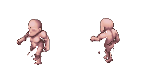

# Rigging & Keyframe Animation Editor — отчет v1.0.0

Дата: 2026-10-27. Эксперимент реализован как отдельный модуль существующего Godot-проекта. Подготовлены редактор, шесть KeyPose, 12 переходов, совместная последовательность и фактические GPU-экспорты. Качество деформации остается экспериментальным и визуальную приемку для игровой анимации не проходит.

## Реализовано

Трехпанельный интерфейс с деревом поз/переходов, pixel zoom 2–32x, pan, выбором/перемещением суставов, числовым вращением, длиной, регистрацией, z-порядком и силой мягкой зоны. Четыре режима разделяют rest, просмотр позы, ключи перехода и последовательность. Несохраненные ключи сохраняются в памяти при смене режима; при смене ресурса и закрытии предлагается сохранение.

Timeline управляет AnimationPlayer: Play/Pause/Stop/Loop, начало/конец, кадр вперед/назад, 30/60 FPS, скорость, длительность, scrub, добавление/перемещение промежуточных ключей. Ключи и переключатели отмечены на timeline и доступны для перетаскивания. Интерполяции: Linear, Ease In, Ease Out, Ease In-Out; углы идут кратчайшим путем.

Обе нарисованные позы участвуют в переходе. Их собственные native-texel поверхности деформируются штатными Skeleton2D/Bone2D/Polygon2D относительно собственных rest. Промежуточный кадр задан общими координатами одноименных суставов и углами, без масштабирования костей. Whole-pose и per-part switch независимы; crossfade настраивается по чанкам, нулевая длительность дает мгновенную смену. Концы используют только соответствующую текстуру.

Есть диагностика костей, суставов, сетки, анатомии, границ, швов, источников Idle/Walk/Aim и исходной текстуры. Геометрия общая для пяти цветов кожи. Все узлы явно перечислены в tscn, динамического создания узлов нет.

## Риги и анатомия

| Ракурс | KeyPose | Источник анатомии |
| --- | --- | --- |
| SW | idle, walk, aim-pistol | Flood Fill v1.1.0 |
| NW | idle, walk, aim-pistol | Flood Fill v1.1.0 |

Реальных принятых ручных коррекций для этих шести случаев не обнаружено. Совместимый read-only импорт Accepted реализован и проверен отдельным синтетическим архивом в cache нового модуля. Непринятые и тестовые пользовательские правки не используются.

Сохраняются реальные 12 путей существующего скелета, без отдельных Hand/Foot костей. 14 групп отображаются по таблице задания; Torso распределен между Pelvis/Spine/Chest. Нативные пиксели сохраняются отдельными ячейками поверхности, мягкие веса ограничены двухпиксельной зоной связных parent/child костей. Старые механизмы многослойных мостов не переносились: они завязаны на прежние Idle-атласы и их метаданные. Новая поверхность не дорисовывает отсутствующие участки.

При проверке обнаружено, что SW Idle ArmL/ArmR старой калибровки расположены напротив одноименных категорий DensePose. Это не скрыто перестановкой меток. Во всех шести НОВЫХ позах суставы инициализированы по собственным анатомическим группам, сохраняется прямое Left → ArmL / Right → ArmR. В `asset-validation.json` сохранены расстояния и сопоставление со старой калибровкой. Старые риги не менялись.

В NW Idle отсутствуют категории правой верхней/нижней ноги и стопы. Явные стартовые ориентиры для этих суставов записаны в `initial-anchors.json` по NW-калибровке. Геометрия и owner-карта не дополняются; пустой чанк показывает предупреждение. Ошибочно отнесенные к Torso пиксели ноги продолжают следовать Torso.

## Анимации и результаты

В каждом из каталогов [SW](exports/south-west/) и [NW](exports/north-west/) находятся шесть независимых ресурсов/последовательностей:

| ID | Переход |
| --- | --- |
| idle_to_walk | Idle → Walk |
| walk_to_idle | Walk → Idle |
| idle_to_aim_pistol | Idle → Aim Pistol |
| aim_pistol_to_idle | Aim Pistol → Idle |
| walk_to_aim_pistol | Walk → Aim Pistol |
| aim_pistol_to_walk | Aim Pistol → Walk |

372 прозрачных PNG 150x150: 12 × 31 кадр, 30 FPS, t=0..1 включительно. [Совместная демонстрация](exports/comparison/) содержит 181 прозрачный PNG 300x150, t=0..6. В обоих ракурсах последовательность Idle → Walk → Aim → Walk → Idle → Aim → Idle выполняется с одинаковыми интервалами, но собственными суставами и параметрами.

[MP4-превью](exports/comparison/demo.mp4): 1200x600, nearest 4x, 30 FPS, 6 секунд; черный фон. Прозрачность сохранена в PNG. Видео закодировано один раз после проверки полного набора кадров, одинакового разрешения и видимого содержимого.

`frames.json` содержит фактически поданные Godot координаты суставов, углы и доли текстур по чанкам; корень — элемент Pelvis с индексом 0. [Пары held-source / held-target](diagnostics/) показывают разницу источников при одном и том же промежуточном скелете. [Первый технологический переход](proof-c/) содержит 31 GPU-кадр. `proof-d/` — историческая проверка SW до уточнения L/R; актуальными итоговыми результатами являются `exports/`.

## Проверки

Исполнение: Godot 4.7.2 stable steam; OpenGL Compatibility; NVIDIA GeForce RTX 3060 Laptop GPU. Python использовался для импорта/подготовки ресурсов и анализа PNG, без собственного движка анимации и растрового рендера.

Технические проверки прошли; подробности в `test-validation.json`, `export-validation.json`, `asset-validation.json` и `preservation-validation.json`.

| Требуемая проверка | Свидетельство |
| --- | --- |
| 1. Шесть поз | Реальная загрузка всех шести JSON и поверхностей Godot |
| 2. Owner-карты | Побитовое сравнение с Flood Fill либо принятой коррекцией; проверка Accepted/Corrected приоритета |
| 3. Группы/кости | 14 групп, реальные пути, L/R, три Torso-владельца, нормированные веса |
| 4. Прозрачность | Все 30 скопированных RGBA совпадают с входными массивами; native rest alpha совпадает |
| 5. Joint roundtrip | Запись и чтение KeyPose в отдельном cache-файле |
| 6. Независимые rest | Изменение одного набора суставов не меняет второй |
| 7–8. Концы | 24 конечных GPU-кадра совпали с отдельным зарегистрированным Sprite2D-референсом: 0 отличающихся RGBA-пикселей |
| 9. Интерполяция | Общие координаты, линейная середина, углы 179 → -179 без полного оборота |
| 10. Reverse | Независимый ресурс обратного перехода не меняется при изменении прямого |
| 11. Промежуточные ключи | Добавление произвольного ключа и воспроизведение его координат; сохранность при смене режима |
| 12. Текстуры | Мгновенный switch, независимые части, положительный blend и точные концы |
| 13. Sequence | Все шесть интервалов, конец, собственные ракурсы; проверены реальный clock и повтор Loop |
| 14. Transition roundtrip | Файловое сохранение/загрузка ключей; численная погрешность < 1e-10 px / 1e-12 rad |
| 15. Godot export | GPU readback SubViewport, 553 проверенных PNG, корректные размеры/режим RGBA/частота |
| 16. Исходники | SHA256 31 219 файлов: изменений и добавлений в защищенных исходных каталогах нет; атласы также проверены по исходному inventory |

В исходном PNG сохраняется ненулевой скрытый RGB некоторых полностью прозрачных пикселей. Framebuffer обнуляет его. Поэтому побитовое сравнение framebuffer с исходным файлом различает 5 994 таких пикселя Idle/SW и 7 930 Aim/SW; альфа, силуэт и весь видимый RGB совпадают. Сравнение с GPU-референсом после одинаковой регистрации дает ноль различий.

Через настоящее окно Computer Use проверены выбор/перемещение и Reset сустава, zoom, каталог, воспроизведение перехода до целевой картинки, scrub, диагностический цвет источника и совместное воспроизведение SW/NW. Автотесты проверяют file roundtrip и промежуточные ключи отдельно. Проверка реального окна дополняет тесты и не означает приемку качества деформации.

## Измерения и визуальная оценка

[Таблица всех 12 переходов](MEASUREMENTS.md); исходные измерения в `measurements.json`.

- Максимальный шаг сустава при 30 FPS: 0.294–0.827 px.
- Расстояние Хаусдорфа между контурами двух текстур при ОДИНАКОВОМ скелете: 10.000–18.248 px. Это изолирует расхождение геометрии/текстур от межкадрового движения.
- Посчитаны кадры с ростом числа связных компонент относительно конечных поз. Это кандидаты разрывов, а не надежная классификация анатомических дыр.
- Посчитана разность силуэтов при удерживаемом скелете. Число проецируемых пикселей, сменивших источник под перекрытиями/blend, и максимальное растяжение texel-геометрии надежно не измерены; в JSON записан null.

Визуально остаются швы и разрывы плеч/предплечий, деформация контуров ног, резкое изменение рук при switch, неправильное перекрытие и эффект двойного контура при blend. На NW влияние неполной разметки сильнее. Автоматического сглаживания, исправления Head/Torso, переноса масок, inpainting и генерации скрытых пикселей нет.

Следующий практический шаг — принять/исправить анатомию в существующем Mask Editor и вручную откалибровать суставы каждой KeyPose, затем настраивать per-part расписания. Это не выполнено автоматически и не входит в утверждение о готовности исследовательского редактора.

## Границы изменений и документация

Изменения ограничены новым модулем. Старые эксперименты, риги, анимационные библиотеки, исходные атласы и алгоритмы не редактировались. Автоматически созданные первым импортом Godot служебные sidecar-файлы в старом workbench были удалены после сверки начального списка; итоговый git-status не содержит изменений старого workbench. Commit/push/merge не выполнялись.

API сверены с официальными [Bone2D](https://docs.godotengine.org/en/stable/classes/class_bone2d.html), [Polygon2D](https://docs.godotengine.org/en/4.6/classes/class_polygon2d.html), [AnimationPlayer](https://docs.godotengine.org/en/4.6/classes/class_animationplayer.html) и [SubViewport capture](https://docs.godotengine.org/en/4.6/tutorials/rendering/viewports.html). Экспорт ожидает завершения кадра RenderingServer перед чтением изображения.
