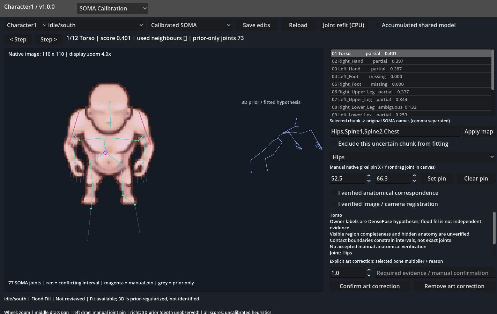
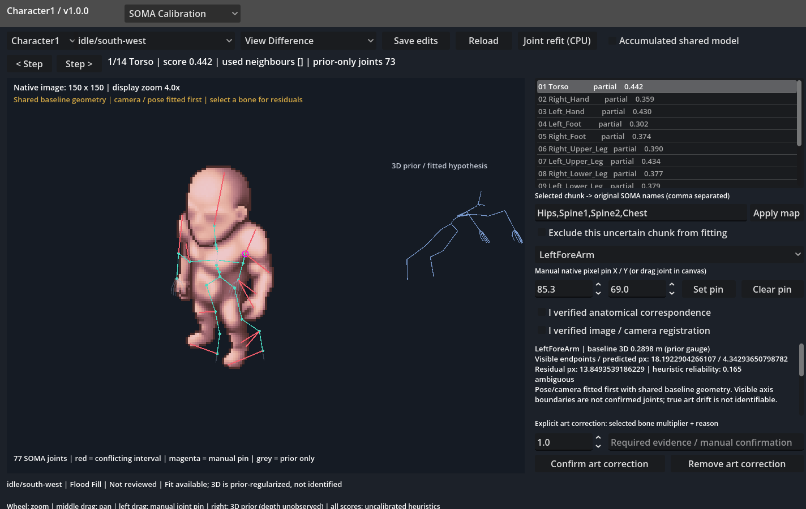

# SOMA Calibration 1.0.0

## Result and limits

The existing Character Rigging Editor has a SOMA Calibration mode. The first
saved fit is Character1 / Idle / South, using the native 110 x 110 image and
DensePose anatomical hypotheses. The standard MotionBricks 0.2.0 skeleton has
all 77 original names and parent indices; no replacement hierarchy is used.

**This is a usable, prior-regularized calibration hypothesis, not a verified
3D anatomical reconstruction.** Absolute metric size, hidden depth, face and
finger anatomy are not identified from these masks. SOMA metre units provide
the canonical gauge; the camera fits native pixels. Sprites are not resized
to fit the skeleton. Display zoom applies equally to image and overlays.

| Stage | Status | Evidence / missing requirement outcome |
| --- | --- | --- |
| A sources, quality, mapping | done | 32 independent authored cases, source hashes, review states, explicit anatomical mapping and source category table |
| B South Idle calibration | partial | Adaptive placement and 77-joint FK fit saved; masks do not establish trustworthy hidden geometry or complete feet |
| C robust refinement and editor | done | Joint refinement, interval conflicts, manual pins/remapping/exclusion, separate save/reload and CPU refit in existing window |
| D South pose drift | partial | Walk/South fits pose first with baseline lengths fixed; true art length changes remain unidentifiable without stronger anatomy |
| E authored view drift | partial | Idle SW/N/NW fit cameras with one shared geometry and Idle pose; unresolved view conflicts preserved |
| F accumulated observations | partial | Gated joint multi-view FK refinement and conditional information gain implemented/tested synthetically; real verified compatible views absent |

No later stage is claimed anatomically successful from unreliable masks.
No confirmed automatic bone-size changes have been established.

## Sources and provenance

See [SOMA-SOURCES.md](SOMA-SOURCES.md) for the explicit category and 14-owner
mapping table. Current source review counts: {'Not reviewed': 25, 'Needs review': 7}.

Each observation keeps raw file signatures (including all five skin sources),
native RGBA pixel identity, baseline skin, native dimensions, owner-map hash,
accepted archive metadata when applicable, review comment/version and actual
atlas mirror metadata. Source masks are never edited. Unknown pixels remain
unknown. Flood propagation is not an independent model vote.

No neural clothing layer, footwear region or repeated LayerDiff seed is
implicitly treated as the same anatomy. No independent agreement score is
claimed without matching image identity, registration and anatomy semantics.
The current independent agreement field is explicitly null.

Original SOMA USD sha256: `4ab93d78a0f1c06d3bcbedee5ceebb5d9d5b002fd0a88638e9399ed80b61871d`.
Pinned upstream commit: `54fc563aeaaf819a753d72cc9fdc6713989cdd43`. The exported canonical
local transforms use original Y-up metres and XYZW quaternions. FK composes
parent and local transforms; pose rotations and length factors are separate.

## Quality and placement

Quality records classification/review, seed support, component contamination,
propagated boundaries, expected neighbour contact, visible completeness and
unobservable overlap. Size is diagnostic, not a reliability term. A connected
component is never automatically reliable. Scores and uncertainty radii are
**uncalibrated heuristics**, not statistical probabilities or covariance.

South Idle missing chunks: Left_Foot, Right_Foot. They contribute no landmarks
or invented pixel owners. Source comments such as North Head/Torso and NW
missing-leg warnings remain visible and lower reliability.

Actual South Idle placement order:

Torso -> Head -> Left_Hand -> Left_Upper_Leg -> Right_Upper_Arm -> Right_Lower_Arm -> Right_Hand -> Right_Upper_Leg -> Left_Upper_Arm -> Left_Lower_Arm -> Left_Lower_Leg -> Right_Lower_Leg

Priority is recomputed after every step from quality, number of constraints,
already placed semantic neighbours and shared joints. It is not a fixed
head-first traversal. Every step stores its reasons, joints, used neighbours,
before/after interval estimates and remaining prior-only coordinates.
Contact/visible PCA endpoints are interval hypotheses, never exact joints.
Torso subdivisions and the neck/head split are explicitly model assumptions.

Joint refinement uses all interval constraints in one soft-L1 robust FK fit,
with weak-mask weights normalized per chunk and explicit canonical priors.
Earlier placement is not locked. Conflicts are saved and drawn red. A missing
upper segment can share an elbow constraint from a forearm; this does not
promote the missing segmentation into observed anatomy.

## Measured pose/view comparisons

First fit uses the South Idle image. Later South poses fit articulated pose
with baseline geometry fixed. Other Idle views fit yaw/pitch/scale/translation
while retaining the same character geometry and Idle pose. The projection is
orthographic; perspective is not identified or claimed estimated.

| Case | Mean outside interval, px | Conflicting constraints | Projection-compatible bone hypotheses | Ambiguous bone hypotheses |
| --- | ---: | ---: | ---: | ---: |
| idle/north-west | 8.982 | 15 | 10 | 3 |
| idle/north | 6.692 | 15 | 15 | 2 |
| idle/south-west | 4.767 | 12 | 13 | 4 |
| idle/south | 1.408 | 4 | 0 | 0 |
| walk/south | 1.952 | 5 | 12 | 5 |

The intervals are visible-axis uncertainty bounds. These errors are not
ground-truth joint accuracy, and the projection-compatible count is not proof
of actual bone length. Each of 76 parent-child bones saves baseline 3D length,
observed endpoint projection when available, predicted projection, residual,
heuristic reliability and proposed correction (null when unidentifiable).

* Confirmed size changes: none from current image evidence. No automatic
  correction has been applied to compensate for noisy masks.
* Projection-compatible differences: only rows whose endpoint discrepancy fits
  the uncertain intervals after pose/camera fitting; no physical size claim.
* Unresolved: out-of-interval residuals, missing feet and hidden depth; poor
  segmentation, occlusion and author art change cannot currently be separated.

An explicit operator-confirmed art correction requires a non-root bone,
multiplier and reason. It is stored as a local pose/view correction, separate
from the baseline. Confirmation is labelled operator evidence, not an
automatically demonstrated anatomical discovery.

Held-out rig-calibration and old KeyPose distances are in
`soma/held-out-controls.json`. Approximate pivot mapping and possible old L/R
differences are explicit. These coordinates are not used by the initializer,
objective or quality score, and cannot circularly validate the result.

## Accumulation

Current status: **partial: no compatible verified multi-view observations**.

Only manually verified same-pose anatomy and registered cameras may contribute.
Mirrors and other poses cannot supply a second depth observation. Parallel
cameras leave rank 2, so no invented 3D position is reported. Nonparallel,
compatible observations can add rank, then jointly refine one shared geometry
and Idle pose, preserving the 77-joint FK structure. The resulting accumulated
model is saved separately and can be selected with Accumulated shared model.
Cases with explicit art geometry corrections are excluded from uncorrected
accumulation, so a known local art change cannot distort the shared baseline.

Information gain is conditional on verified cameras/correspondences and uses
heuristic measurement widths. It is not statistically calibrated confidence.
The original South-only baseline remains available for drift comparison.

## Editor and files

Launch from this module:

```powershell
.\run.ps1 soma-editor
```

Or select SOMA Calibration in the existing editor mode selector. Choose a case
and Source / Chunks / Placement / Canonical SOMA / Calibrated SOMA / Pose
Difference / View Difference. Previous/Next steps show placement order;
tooltips record reasons, neighbours and unknown depth. Refined skeleton and
initial interval estimates can be compared in Placement. Right inset shows
the spatial prior/fitted hypothesis; grey joints are prior-only.

Select a chunk to inspect quality, remap ordered SOMA names or exclude a wrong
mask. Select/drag a joint or set a native pixel pin. Save edits writes a
separate override. Joint refit invokes the CPU solver without a console and
keeps source masks immutable. Case switches preserve edits; mode switches
retain the SOMA session; editor close includes its unsaved changes. Invalid or
stale override files fail explicitly. Refit errors retain their full traceback.

The first five saved cases are ready. Other cases have observations and images
and can be fitted with Joint refit after checking masks. No alternate pose or
view is silently substituted for a missing source.

* `soma/canonical.json`: original 77-joint canonical local transforms.
* `soma/geometry.json`: shared South Idle geometry hypothesis.
* `soma/observations/`: immutable-source-derived quality/landmarks/provenance.
* `soma/cases/`: placement trace, optimized model, uncertainty/conflicts/drift.
* `soma/poses/`: separate articulated poses, cameras and explicit art corrections.
* `soma/overrides/`: saved manual constraints, mapping and verification flags.
* `soma/accumulation.json`: gated joint refinement and compatible evidence.
* `soma/assets/`: copies of native source and diagnostic owner-colour overlays.
* `soma/proof/`: GPU screenshots and UI verification record.
* `soma/cache/`: ignored requests/status and isolated test workspace.

Stable local commands: `soma-build`, `soma-fit`, `soma-test`, `soma-proof`,
`soma-report`, `soma-editor`. The existing pinned MotionBricks Python runtime
provides NumPy/SciPy/Pillow for CPU fitting; no model inference, training or
MotionBricks animation generation is run. No new experiment directory exists.

## Verification

CPU verification: 21 tests,
failures 0, errors 0.
Checks cover exact hierarchy, rigid FK composition, pose length invariants,
native projection and foreshortening, adaptive ordering, conflicting intervals,
missing masks, weak outliers, manual mapping/pins, explicit local art changes,
source hashes, save roundtrip, accumulation gates/rank and conditional multi-view
information gain. Synthetic tests establish mechanics, not image ground truth.

GPU UI verification: {'gui_cpu_refit': True, 'legacy_mode_return': True, 'manual_pin': True, 'override_store': 'isolated cache', 'save_reload_switch': True, 'screenshot_layers': 7}. The test override workspace is isolated; proof pins
do not become real character observations. Seven displayed modes are saved.
The actual panel launches the CPU solver and reads its matching job result.

Legacy GPU regression: 14 checks and
12 endpoints;
previous rigs/transitions remain usable. Original source signatures for all
32 authored cases are checked unchanged. All new implementation and outputs
stay in Character Rigging Editor. No commit/push was performed.

## GPU views

South Idle fitted hypothesis (grey anatomy is prior-only):



SouthWest comparison with unresolved interval conflicts in red:


