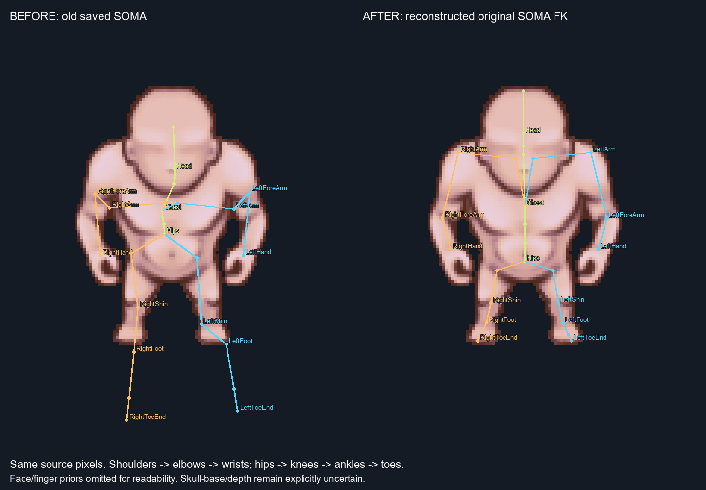
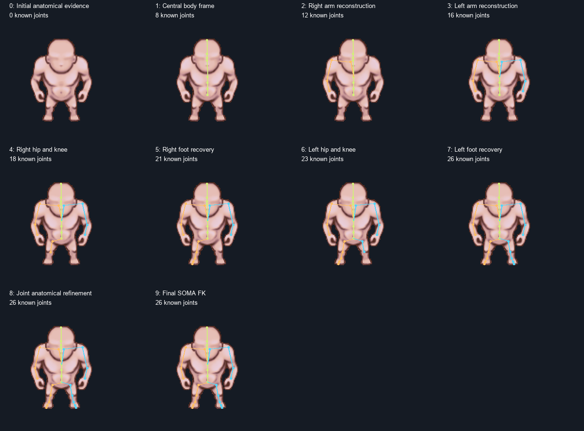

# SOMA Calibration: anatomical reconstruction repair 2.0.0

## Current result

**Character1 / Idle / South now has an image-consistent anatomical hypothesis:**
central spine, shoulders above elbows, wrists at the hand attachments, plausible
hip/knee/ankle chains and both feet inside the original visible silhouette.
The result was visually inspected against the actual sprite and masks; numerical
solver success is not used as proof of anatomy. The complete original 77-joint
MotionBricks SOMA hierarchy, joint names, quaternions and Y-up coordinates remain.

The repair implements the puzzle effect: missing feet are recovered from the
leg chain and alpha; a misplaced left knee uses the more coherent right leg;
removed arm labels are reconstructed from retained fragments, the opposite
arm's proportions and the affected arm's own silhouette. No stored reference
joint coordinates are supplied to these corruption reconstructions.

Depth, skull-base/neck pivots behind the large head, hidden joints and absolute
metric size remain uncertain. Aim is an additional **partial** result: severely
occluded arm correspondence cannot be claimed uniquely recognized. North/NW
still contain explicitly flagged semantic/occlusion conflicts; they are not
claimed independently validated by the South result.



## What was wrong, and why

The original failure was inspected and preserved **before** algorithm changes:
[sprite + owners + old SOMA + old landmarks](soma/anatomy/before/diagnostic.png),
[numeric source evidence](soma/anatomy/before/diagnostic.json),
[original saved fit](soma/anatomy/before/idle-south.json).

* Upper-arm PCA sign was chosen from the torso centroid. The torso extends
  below the shoulder cap, so this assigned the distal end to the shoulder and
  the proximal end to the elbow. Old LeftArm/LeftForeArm Y were
  57.72/51.72; right were
  57.38/52.60.
* A torso mask's diagonal principal axis was treated as a spine. Broad unrelated
  intervals and weak pose/geometry priors allowed an off-centre, asymmetric
  configuration rather than a coherent central body and paired attachments.
* Both Foot semantic categories were missing, but **all 3713
  alpha pixels were classified**. Foot pixels were included in lower-leg
  categories. No-foot-category was incorrectly interpreted as no geometry.
  Unconstrained canonical toes reached Y
  126.33/129.52
  in a 110-pixel image. The old left lower-leg mask also covered mainly the
  terminal foot, placing its supposed knee too low.
* Placement sorted intervals and logged them, but its result did not initialize
  the kinematic fit. The canvas then drew the final optimized skeleton even
  at the first placement step. This was a diagnostic ordering, not reconstruction.

## Corrected anatomical interpretation

Actual canonical rest transforms and parents were checked. `LeftShoulder`
is the clavicle root; **LeftArm is the shoulder joint, LeftForeArm the elbow,
LeftHand the wrist**. `LeftLeg` is the hip/thigh root, `LeftShin` the knee,
`LeftFoot` the ankle. ToeBase/ToeEnd are forefoot/toe continuation. Right-side
names have the matching meanings. The visible chin is not a detected neck pivot.

PCA is now only an unoriented shape diagnostic. Its endpoints do not become
joints. The reconstruction instead uses ordered chains, corroborated interfaces,
proximal cap interiors, body attachment relationships and visible interior paths.
Each source/derived observation keeps provenance, status, reasons and a heuristic
uncertainty interval. Semantic absence and geometric recovery remain distinct.

The source alpha participates directly: geodesic paths cannot cross transparent
pixels, and joint/bone hypotheses are checked against the silhouette. A distal
leg width transition and terminal support form a separate foot proposal when
Foot labels are absent. When Foot labels exist and agree with a lower-leg
contact and alpha, they constrain the correct foot even across the image midline.
This last distinction fixes the crossed/overlapping feet in Aim.

Only a verified frontal composition with both global and lateral-limb alpha
agreement activates the soft pose-symmetry constraint. South Idle alpha mirror
IoU is 0.999461.
A large symmetric head cannot by itself turn asymmetric arms into a symmetric
pose. Anatomical pairing supplies segment proportions and attachment geometry;
it does not copy reflected joint coordinates. Walk and SW do not activate pose
symmetry. Small independent differences remain permitted in South Idle.

## Actual sequential reconstruction



State starts with zero placed joints. A central body frame establishes torso
attachments. An adaptive queue chooses available chains using semantic quality,
chain coherence and newly available paired information. A recovered chain
updates the pool of segment proportions and constrains later searches. When
neither arm is complete, independently observed upper/lower fragments from both
sides are pooled before missing portions are searched in their own alpha.

The sequential state is the actual initial state for joint refinement. It is not
recomputed from a saved final rig. Refinement can move earlier hypotheses, uses
the original alpha and only evidence-supported pose symmetry, then expresses the
result as calibrated local offsets plus articulated rotations of the original
SOMA. Branch geometry at pelvis/chest is part of character geometry; unobserved
face/finger children keep their canonical local prior. FK reconstructs the saved
spatial joint positions and projection, rather than displaying an unrelated 2D rig.

For other poses/views, camera and articulated pose are fitted with shared South
geometry first. The view's apparent left/right projected lengths do not silently
become different 3D bone lengths. Explicit operator-confirmed art corrections
remain separate and require a reason. No automatic confirmed art-size change is
claimed from these masks. Shared-geometry accumulation handles the calibrated
local-offset representation and retains semantic/registration gates.

## Control cases and visual review

| Control | Actual image evidence and outcome |
| --- | --- |
| A South Idle | Central axial chain, ordered lowered arms, hips/knees/ankles aligned with the drawing; no remote canonical toe continuation |
| B missing Foot owners | Both semantic categories still absent; two separate visible foot proposals from alpha + leg chain, original labels unchanged |
| C incomplete arm | Upper, lower and mutually complementary fragment removals tested on copied labels, original sprite/alpha preserved |
| D asymmetry | Walk keeps unequal arm positions; hand Y difference 14.00 px; no pose mirroring |
| E diagonal | SW keeps different projections with exactly the shared character geometry; no automatic 3D asymmetry claim |
| F incorrect labels | 52 foot pixels falsely labelled UpperArm; the specific competing fragment is detected and does not pull the arm to the foot |
| Additional Aim | Feet are separated using corroborated foot/leg contacts; occluded arm observations remain bounded hypotheses, not confirmed joints |

| Copied-label corruption | Removed IDs | Maximum arm displacement from intact run, px | Interpretation |
| --- | --- | ---: | --- |
| C-upper-arm-removed | [10] | 1.82 | anatomical order retained, own alpha used |
| C-lower-arm-removed | [12] | 1.05 | anatomical order retained, own alpha used |
| C-complementary-fragments | [10, 2] | 2.69 | anatomical order retained, own alpha used |

Displacement is a sensitivity diagnostic, not a substitute for visual accuracy.
The intact result is **not an input** to the reconstruction of corrupted cases.
Actual copied owner maps and unchanged alpha are saved under
`soma/anatomy/checks/inputs/`; each result records the diagnostic owner hash
separately from the original source identity.

South Idle maximum paired Y difference is 0.167 px;
all displayed main joints are within the alpha. These measurements support the
overlays; they do not independently prove a unique skeleton. The left knee's
original semantic boundary remains a reported contradiction, not a silently
rewritten mask.

Visual inspection record: `Codex visual inspection of actual source/owner/SOMA overlays, including before/after and GPU placement states`. Its limits and per-case notes
are in [visual-review.json](soma/anatomy/visual-review.json).

* [Intact South + masks + reconstructed SOMA](soma/anatomy/checks/A-south-idle.png)
* [Upper arm removed](soma/anatomy/checks/C-upper-arm-removed.png)
* [Lower arm removed](soma/anatomy/checks/C-lower-arm-removed.png)
* [Complementary missing fragments](soma/anatomy/checks/C-complementary-fragments.png)
* [Asymmetric Walk](soma/anatomy/checks/D-asymmetric-walk.png)
* [Diagonal SW](soma/anatomy/checks/E-diagonal-idle.png)
* [Incorrect owner on foot](soma/anatomy/checks/F-wrong-owner.png)
* [Aim with explicit occlusion ambiguity](soma/anatomy/checks/D-aim-occlusion.png)

## Editor and verification

SOMA Calibration remains in the existing editor. Source/Chunks overlays show
the actual sprite, original masks, anatomical colours and selected joint names.
Pink is proposed visible foot geometry; it does not overwrite ownership.
Placement draws only that step's established joints and recovered regions;
its inspector also omits later final coordinates. Before/after states, reasons,
used neighbours, uncertainty and conflicts remain stored. Occluded hypotheses
are dashed. Full 77 joints is a separate option; the default view omits the
unreadable mass of unobserved face/finger lines.
The placement counter counts initialized hypotheses, including explicitly
uncertain hidden pivots; it is not a count of independently verified detections.

Manual joint pins, mappings, mask exclusions and explicit art corrections remain
separate from source data. Save/reload/case switching and the actual GUI-to-CPU
refit are verified in an isolated override workspace. GPU screenshots include
[initial state](soma/anatomy/gpu/run-1793181199-239/placement/step-00.png),
[one recovered foot](soma/anatomy/gpu/run-1793181199-239/placement/step-05.png),
[calibrated view](soma/anatomy/gpu/run-1793181199-239/4.png) and [full SOMA](soma/anatomy/gpu/run-1793181199-239/full-77.png).

GPU captures use a distinct run folder and atomically publish `proof/latest.json`
only after all screenshots and the GUI refit succeed. Existing open images are
not overwritten during a capture. The earlier stable proof images remain as
historical artifacts.

CPU verification: 22 tests, 0 failures,
0 errors. GPU GUI verification: True.
Legacy editor regression: 14 checks; the original
12 endpoint states and transitions remain usable. Technical assertions are
supplementary to the actual-image controls above.

All 32 original source signatures are checked unchanged. Source PNGs, original
owners/Flood Fill, MotionBricks, Workbench, old KeyPose and transitions are not
edited. No commit/push, animation generation or sprite deformation is performed.

Stable commands from this module:

```powershell
.\run.ps1 soma-anatomy-inspect
.\run.ps1 soma-anatomy-hypothesis
.\run.ps1 soma-build
.\run.ps1 soma-anatomy-checks
.\run.ps1 soma-test
.\run.ps1 soma-proof
.\run.ps1 soma-report
.\run.ps1 soma-editor
```

`soma-anatomy-hypothesis` saves the pre-optimizer visual hypothesis. The original
snapshot is preserved and is never used by fitting. Reports and test artifacts
stay in this module. The existing pinned CPU Python runtime supplies SciPy;
no new neural model is downloaded or run.

Implementation references: [SciPy vector-frame alignment](https://docs.scipy.org/doc/scipy/reference/generated/scipy.spatial.transform.Rotation.align_vectors.html)
and [Euclidean distance/nearest-feature transform](https://docs.scipy.org/doc/scipy/reference/generated/scipy.ndimage.distance_transform_edt.html).
Single-view reconstruction is a prior-selected representative. Metric scale,
depth, hidden pivots and unknown hand articulation remain unresolved.

## Historical report, preserved verbatim

The text below records the **previous implementation**, including its incorrect
inference that absent Foot categories imply absent foot geometry and its old
stage statuses. It is retained for traceability and is superseded by the
current actual-image results above.

---

# SOMA Calibration 1.0.0

## Result and limits

The existing Character Rigging Editor has a SOMA Calibration mode. The first
saved fit is Character1 / Idle / South, using the native 110 x 110 image and
DensePose anatomical hypotheses. The standard MotionBricks 0.2.0 skeleton has
all 77 original names and parent indices; no replacement hierarchy is used.

**This is a usable, prior-regularized calibration hypothesis, not a verified
3D anatomical reconstruction.** Absolute metric size, hidden depth, face and
finger anatomy are not identified from these masks. SOMA metre units provide
the canonical gauge; the camera fits native pixels. Sprites are not resized
to fit the skeleton. Display zoom applies equally to image and overlays.

| Stage | Status | Evidence / missing requirement outcome |
| --- | --- | --- |
| A sources, quality, mapping | done | 32 independent authored cases, source hashes, review states, explicit anatomical mapping and source category table |
| B South Idle calibration | partial | Adaptive placement and 77-joint FK fit saved; masks do not establish trustworthy hidden geometry or complete feet |
| C robust refinement and editor | done | Joint refinement, interval conflicts, manual pins/remapping/exclusion, separate save/reload and CPU refit in existing window |
| D South pose drift | partial | Walk/South fits pose first with baseline lengths fixed; true art length changes remain unidentifiable without stronger anatomy |
| E authored view drift | partial | Idle SW/N/NW fit cameras with one shared geometry and Idle pose; unresolved view conflicts preserved |
| F accumulated observations | partial | Gated joint multi-view FK refinement and conditional information gain implemented/tested synthetically; real verified compatible views absent |

No later stage is claimed anatomically successful from unreliable masks.
No confirmed automatic bone-size changes have been established.

## Sources and provenance

See [SOMA-SOURCES.md](SOMA-SOURCES.md) for the explicit category and 14-owner
mapping table. Current source review counts: {'Not reviewed': 25, 'Needs review': 7}.

Each observation keeps raw file signatures (including all five skin sources),
native RGBA pixel identity, baseline skin, native dimensions, owner-map hash,
accepted archive metadata when applicable, review comment/version and actual
atlas mirror metadata. Source masks are never edited. Unknown pixels remain
unknown. Flood propagation is not an independent model vote.

No neural clothing layer, footwear region or repeated LayerDiff seed is
implicitly treated as the same anatomy. No independent agreement score is
claimed without matching image identity, registration and anatomy semantics.
The current independent agreement field is explicitly null.

Original SOMA USD sha256: `4ab93d78a0f1c06d3bcbedee5ceebb5d9d5b002fd0a88638e9399ed80b61871d`.
Pinned upstream commit: `54fc563aeaaf819a753d72cc9fdc6713989cdd43`. The exported canonical
local transforms use original Y-up metres and XYZW quaternions. FK composes
parent and local transforms; pose rotations and length factors are separate.

## Quality and placement

Quality records classification/review, seed support, component contamination,
propagated boundaries, expected neighbour contact, visible completeness and
unobservable overlap. Size is diagnostic, not a reliability term. A connected
component is never automatically reliable. Scores and uncertainty radii are
**uncalibrated heuristics**, not statistical probabilities or covariance.

South Idle missing chunks: Left_Foot, Right_Foot. They contribute no landmarks
or invented pixel owners. Source comments such as North Head/Torso and NW
missing-leg warnings remain visible and lower reliability.

Actual South Idle placement order:

Torso -> Head -> Left_Hand -> Left_Upper_Leg -> Right_Upper_Arm -> Right_Lower_Arm -> Right_Hand -> Right_Upper_Leg -> Left_Upper_Arm -> Left_Lower_Arm -> Left_Lower_Leg -> Right_Lower_Leg

Priority is recomputed after every step from quality, number of constraints,
already placed semantic neighbours and shared joints. It is not a fixed
head-first traversal. Every step stores its reasons, joints, used neighbours,
before/after interval estimates and remaining prior-only coordinates.
Contact/visible PCA endpoints are interval hypotheses, never exact joints.
Torso subdivisions and the neck/head split are explicitly model assumptions.

Joint refinement uses all interval constraints in one soft-L1 robust FK fit,
with weak-mask weights normalized per chunk and explicit canonical priors.
Earlier placement is not locked. Conflicts are saved and drawn red. A missing
upper segment can share an elbow constraint from a forearm; this does not
promote the missing segmentation into observed anatomy.

## Measured pose/view comparisons

First fit uses the South Idle image. Later South poses fit articulated pose
with baseline geometry fixed. Other Idle views fit yaw/pitch/scale/translation
while retaining the same character geometry and Idle pose. The projection is
orthographic; perspective is not identified or claimed estimated.

| Case | Mean outside interval, px | Conflicting constraints | Projection-compatible bone hypotheses | Ambiguous bone hypotheses |
| --- | ---: | ---: | ---: | ---: |
| idle/north-west | 8.982 | 15 | 10 | 3 |
| idle/north | 6.692 | 15 | 15 | 2 |
| idle/south-west | 4.767 | 12 | 13 | 4 |
| idle/south | 1.408 | 4 | 0 | 0 |
| walk/south | 1.952 | 5 | 12 | 5 |

The intervals are visible-axis uncertainty bounds. These errors are not
ground-truth joint accuracy, and the projection-compatible count is not proof
of actual bone length. Each of 76 parent-child bones saves baseline 3D length,
observed endpoint projection when available, predicted projection, residual,
heuristic reliability and proposed correction (null when unidentifiable).

* Confirmed size changes: none from current image evidence. No automatic
  correction has been applied to compensate for noisy masks.
* Projection-compatible differences: only rows whose endpoint discrepancy fits
  the uncertain intervals after pose/camera fitting; no physical size claim.
* Unresolved: out-of-interval residuals, missing feet and hidden depth; poor
  segmentation, occlusion and author art change cannot currently be separated.

An explicit operator-confirmed art correction requires a non-root bone,
multiplier and reason. It is stored as a local pose/view correction, separate
from the baseline. Confirmation is labelled operator evidence, not an
automatically demonstrated anatomical discovery.

Held-out rig-calibration and old KeyPose distances are in
`soma/held-out-controls.json`. Approximate pivot mapping and possible old L/R
differences are explicit. These coordinates are not used by the initializer,
objective or quality score, and cannot circularly validate the result.

## Accumulation

Current status: **partial: no compatible verified multi-view observations**.

Only manually verified same-pose anatomy and registered cameras may contribute.
Mirrors and other poses cannot supply a second depth observation. Parallel
cameras leave rank 2, so no invented 3D position is reported. Nonparallel,
compatible observations can add rank, then jointly refine one shared geometry
and Idle pose, preserving the 77-joint FK structure. The resulting accumulated
model is saved separately and can be selected with Accumulated shared model.
Cases with explicit art geometry corrections are excluded from uncorrected
accumulation, so a known local art change cannot distort the shared baseline.

Information gain is conditional on verified cameras/correspondences and uses
heuristic measurement widths. It is not statistically calibrated confidence.
The original South-only baseline remains available for drift comparison.

## Editor and files

Launch from this module:

```powershell
.\run.ps1 soma-editor
```

Or select SOMA Calibration in the existing editor mode selector. Choose a case
and Source / Chunks / Placement / Canonical SOMA / Calibrated SOMA / Pose
Difference / View Difference. Previous/Next steps show placement order;
tooltips record reasons, neighbours and unknown depth. Refined skeleton and
initial interval estimates can be compared in Placement. Right inset shows
the spatial prior/fitted hypothesis; grey joints are prior-only.

Select a chunk to inspect quality, remap ordered SOMA names or exclude a wrong
mask. Select/drag a joint or set a native pixel pin. Save edits writes a
separate override. Joint refit invokes the CPU solver without a console and
keeps source masks immutable. Case switches preserve edits; mode switches
retain the SOMA session; editor close includes its unsaved changes. Invalid or
stale override files fail explicitly. Refit errors retain their full traceback.

The first five saved cases are ready. Other cases have observations and images
and can be fitted with Joint refit after checking masks. No alternate pose or
view is silently substituted for a missing source.

* `soma/canonical.json`: original 77-joint canonical local transforms.
* `soma/geometry.json`: shared South Idle geometry hypothesis.
* `soma/observations/`: immutable-source-derived quality/landmarks/provenance.
* `soma/cases/`: placement trace, optimized model, uncertainty/conflicts/drift.
* `soma/poses/`: separate articulated poses, cameras and explicit art corrections.
* `soma/overrides/`: saved manual constraints, mapping and verification flags.
* `soma/accumulation.json`: gated joint refinement and compatible evidence.
* `soma/assets/`: copies of native source and diagnostic owner-colour overlays.
* `soma/proof/`: GPU screenshots and UI verification record.
* `soma/cache/`: ignored requests/status and isolated test workspace.

Stable local commands: `soma-build`, `soma-fit`, `soma-test`, `soma-proof`,
`soma-report`, `soma-editor`. The existing pinned MotionBricks Python runtime
provides NumPy/SciPy/Pillow for CPU fitting; no model inference, training or
MotionBricks animation generation is run. No new experiment directory exists.

## Verification

CPU verification: 21 tests,
failures 0, errors 0.
Checks cover exact hierarchy, rigid FK composition, pose length invariants,
native projection and foreshortening, adaptive ordering, conflicting intervals,
missing masks, weak outliers, manual mapping/pins, explicit local art changes,
source hashes, save roundtrip, accumulation gates/rank and conditional multi-view
information gain. Synthetic tests establish mechanics, not image ground truth.

GPU UI verification: {'gui_cpu_refit': True, 'legacy_mode_return': True, 'manual_pin': True, 'override_store': 'isolated cache', 'save_reload_switch': True, 'screenshot_layers': 7}. The test override workspace is isolated; proof pins
do not become real character observations. Seven displayed modes are saved.
The actual panel launches the CPU solver and reads its matching job result.

Legacy GPU regression: 14 checks and
12 endpoints;
previous rigs/transitions remain usable. Original source signatures for all
32 authored cases are checked unchanged. All new implementation and outputs
stay in Character Rigging Editor. No commit/push was performed.

## GPU views

South Idle fitted hypothesis (grey anatomy is prior-only):


SouthWest comparison with unresolved interval conflicts in red:


