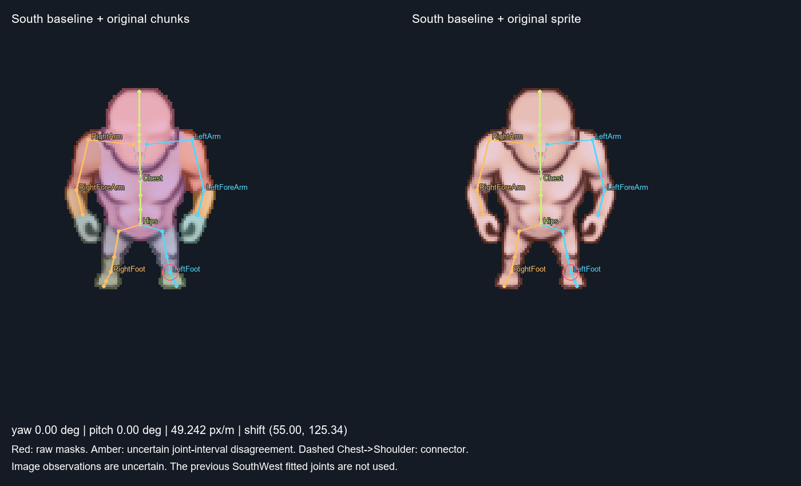
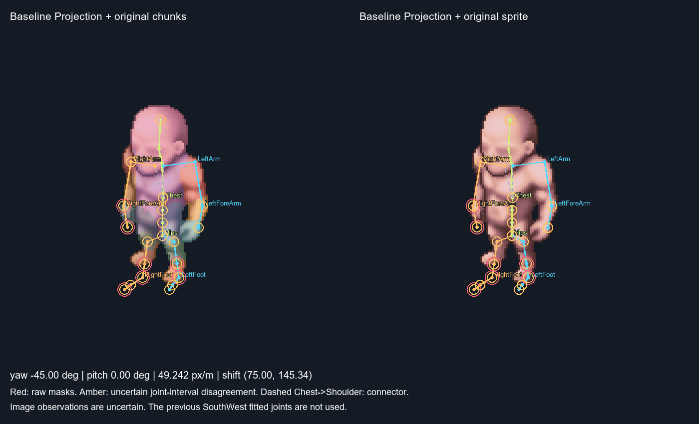
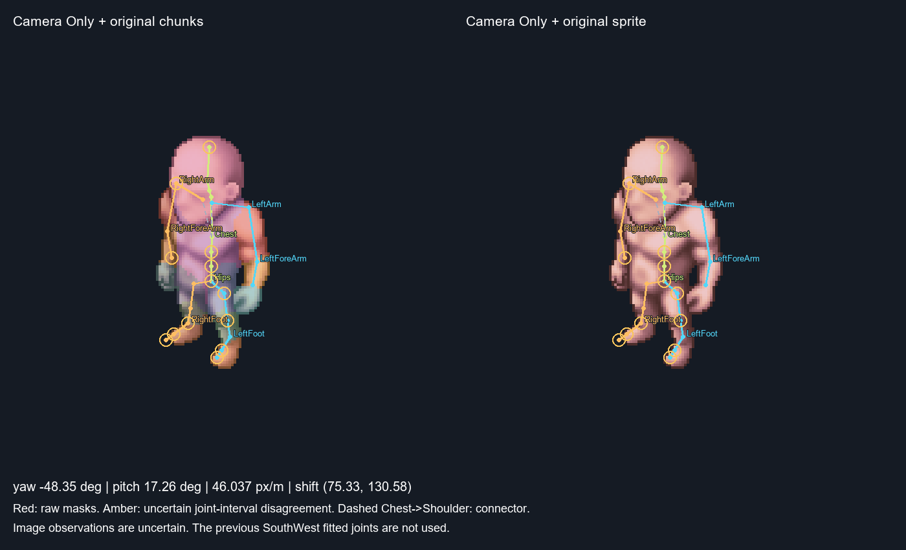
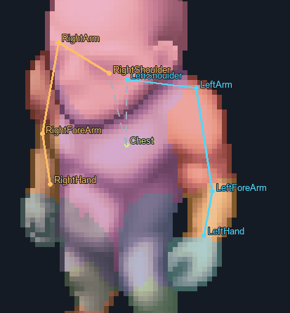

# SOMA Multi-View Calibration: South Idle -> SouthWest Idle

## Result

One **unchanged** South Idle SOMA geometry and pose gives a good account of the
visible SouthWest anatomical regions after changing the camera. No extra geometry,
rotation or art delta is currently justified. This is a camera-only compatibility
result, not proof that all hidden joints or depth estimates are anatomically exact.

The original South model, old SW fit and source images/masks are not overwritten.
Only these two Idle images are evaluated; no Walk/Aim or other-view calibration
is performed. No animation generation or commit/push is performed.

## 1. Frozen baseline

Baseline: `Character1/idle/south@866f848c1b25ded2`, from repository commit `33d337d`.
Its immutable snapshot is `soma/multiview/south-baseline.json`, including canonical
77 names/parents, calibrated local offsets, local rotations, root/world placement,
original South camera, source identity and protected file checksums.

All 77 joints, including unobserved face/finger joints, are frozen during Camera
Only. The optimization has exactly five parameters: yaw, pitch, one uniform
orthographic pixels-per-metre scale, tx and ty. There are no per-joint screen
offsets, root rotations, length variables or nonuniform scale variables.

The baseline's depth and hidden skull-base/neck, Chest and shoulder-root positions
were prior-selected from South and remain uncertain. The new view is not used
to retroactively label them as independently detected.



## 2. Camera Only

| Camera parameter | Initial SW hypothesis | Fitted |
| --- | ---: | ---: |
| yaw, degrees | -45.000 | -48.345 |
| pitch, degrees | 0.000 | 17.259 |
| pixels/metre, uniform | 49.2416 | 46.0375 |
| tx, native pixels | 75.0000 | 75.3308 |
| ty, native pixels | 145.3352 | 130.5840 |

Yaw starts at South minus 45 degrees under the existing Y-up convention. Initial
translation accounts for native image canvas size (South 110, SW 150 pixels).
The final angle is fitted, not clamped to 45 degrees. The sprite and masks keep
their original native geometry; only one rigid projection changes.

The objective combines **raw owner-mask distance fields**, original alpha
support for visible anatomical segments and uncertain anatomical intervals
extracted afresh from source masks. Occluded pivots and clavicle roots are not
forced onto the visible silhouette. Chest->Shoulder is excluded as a supposed
visible physical bone: it is a kinematic connector.

The previous `cases/idle/south-west.json` pose/joints are not read by this
objective. A test actively blocks that file while repeating Camera Only. No
independent SW skeleton is lifted or fitted as the model for this run.





| Diagnostic | Initial projection | Camera Only |
| --- | ---: | ---: |
| Mean centreline distance from corresponding raw owner masks, px | 4.532 | 0.216 |
| Maximum sampled visible-segment alpha distance, px | 12.319 | 0.757 |
| Mean amount outside inferred joint intervals, px | 7.384 | 0.846 |

These are support diagnostics, **not ground-truth joint accuracy**. Segment
sampling excludes uncertain endpoint seams; passing it does not validate every
pivot. The fit was also visually inspected on the actual sprite and shoulder
close-up. Limbs retain their proper order and the visibly unequal left/right
projections follow from the same 3D geometry and camera.

## 3. Remaining disagreements and causes

Amber rings mark disagreements with inferred intervals, not proven errors in
the skeleton. Raw-mask contradictions, when present, use red rings.

| Joint hypothesis | Distance, px | Heuristic radius, px | Outside interval, px |
| --- | ---: | ---: | ---: |
| LeftLeg | 8.53 | 3.00 | 5.53 |
| RightArm | 5.79 | 2.50 | 3.29 |
| Hips | 5.88 | 3.00 | 2.88 |
| Spine1 | 4.69 | 3.00 | 1.69 |
| RightToeEnd | 3.58 | 2.50 | 1.08 |
| RightToeBase | 3.50 | 2.50 | 1.00 |
| RightFoot | 3.09 | 2.50 | 0.59 |
| Spine2 | 3.56 | 3.00 | 0.56 |
| RightHand | 2.92 | 2.50 | 0.42 |
| LeftToeEnd | 2.84 | 2.50 | 0.34 |
| LeftShin | 3.75 | 3.50 | 0.25 |
| LeftToeBase | 2.62 | 2.50 | 0.12 |
| HeadEnd | 3.01 | 3.00 | 0.01 |

* **Pelvis/hip attachments:** the strongest discrepancy is the LeftLeg attachment
  interval. A DensePose torso/thigh seam and its centroid are not an observed hip
  pivot. The projected femur still has visible upper-leg support. A wrong seam,
  uncertain depth/attachment, slight Idle variation or an art difference remain
  possible; the mask alone cannot select one explanation.
* **Hips/Spine/Chest:** the central chain is inside the body. Hips and lower spine
  differ from the unrefined 2D body-frame hypotheses. This is not evidence for
  moving the entire torso to fit those heuristic points exactly.
* **Shoulder girdle:** visible upper/lower arms are compatible with this projection.
  RightArm differs from its cap-based interval; deltoid contour, actual joint
  centre, occlusion by the head and unknown depth can explain part of that gap.
  Hidden Chest/clavicle roots are not independently confirmed by raw mask coverage.
* **Feet:** the right ankle/forefoot intervals retain a small residual. Endpoint
  rasterization, imperfect owner boundaries, local foot pose or art variation are
  possible. No length/art change is declared from that single disagreement.
* **Neck/head:** their hidden pivots are excluded from visible-joint attachment
  claims. The visible head region is compatible, but depth and skull-base pose
  remain prior-dependent.



Dashed Chest->LeftShoulder/RightShoulder links show hierarchy/attachment offsets,
not a claim that a physical bone runs along each dashed line. The close-up
retains Chest -> Shoulder -> Arm -> ForeArm -> Hand for both sides.

## 4. Delta history and deterministic application

| Delta type | Changed joints | Status |
| --- | ---: | --- |
| shared_geometry | 0 | not applied: no sufficiently justified correction |
| pose | 0 | not applied: no sufficiently justified correction |
| art_geometry | 0 | not applied: no sufficiently justified correction |

Empty records are intentional. Camera Only already explains visible owner
regions within their uncertainty; fitting free depth/rotations merely to erase
uncertain interval residuals would obscure their cause. No spatial-depth or
bone-length change is reported as newly established, and no artistic deformation
is declared proven from this view.

The camera record stores before/after values for all five parameters. Every
model delta stores the source model fingerprint, image identity, view, type,
reason, confirmation status, changed-joint before/after parameters and two-view
validation. Geometry and pose records are separate. None is promoted to the
baseline. The art record is view-local and does not enter the South projection.

`replay()` always starts from a fresh copy of the immutable baseline, applies
shared geometry, then SW pose and view-local art in order. It never compounds
changes onto the last loaded state. Repeated direct application with mismatched
before-values is rejected. Wrong model/image/type and nonuniform cameras fail
explicitly. Tests exercise nonempty depth/pose/art **synthetic application fixtures**;
these fixtures are not actual corrections or evidence about this character.

`mv-replay` deterministically regenerates all stages from `deltas.json` without
running a new fit. Actual two-view metrics, including any South compromise, are
saved in `replay-validation.json` rather than assumed from delta annotations.

## 5. South preservation and final result

Maximum South projected-joint change after the shared delta is
**0.000000000000 native pixels**. Calibrated
local offsets, rotations and all original protected baseline files are unchanged.
The before/after South images are consequently identical.


**Conclusion:** one frozen 3D geometry and the original South Idle pose explain
the visible anatomy of both images reasonably well by camera change alone.
That establishes compatibility for these observations; it does not uniquely
determine depth or settle the hidden pelvis/shoulder-root hypotheses. Exact
joint-centre agreement and any true artistic proportion change remain unresolved.
The result is good for visible projection, partial for full anatomical validation.

## 6. Existing editor and verification

The six `MV:` choices are in the existing SOMA Calibration layer selector:
Baseline Projection, Camera Only, Shared Geometry, Pose Delta, Art Delta and
Final Comparison. Previous/Next also traverse these stages. Original sprite,
chunks, camera parameters, interval disagreements and a South projection in
the original South camera are shown. Shoulder chains provides a readable close-up;
Full 77 joints remains available. Staged views are read-only so a drag cannot
silently turn Camera Only into per-joint screen editing. Normal editor modes
and their manual editing remain available on leaving the staged view.

Verification: **12 tests**, success `True`;
GPU stage/shoulder/full-77/back-to-editor checks `True`.
Automated controls cover every frozen joint/world transform, five camera DOFs,
raw masks contributing without generated joint targets, exclusion of the prior
SW fit, deterministic repeated replay, source identities, preservation of South
and separation of depth/pose/art effects. Visual inspection supplements tests.

[GPU Camera Only](soma/multiview/proof/run-2144472/1.png),
[GPU final comparison](soma/multiview/proof/run-2144472/5.png),
[GPU shoulder chains](soma/multiview/proof/run-2144472/shoulders.png).

Commands from this module (all scripts/results remain here):

```powershell
.\run.ps1 mv-build
.\run.ps1 mv-test
.\run.ps1 mv-replay
.\run.ps1 mv-proof
.\run.ps1 mv-report
.\run.ps1 mv-editor
```

`mv-build` repeats the camera fit and records the evidence-based empty corrections.
`mv-replay` loads saved records without refitting. An altered source baseline is
rejected rather than silently overwriting the immutable snapshot. Existing
South geometry, old SW fit, source PNGs/masks, Workbench and MotionBricks stay
unchanged. No other poses or viewpoints are calibrated.
