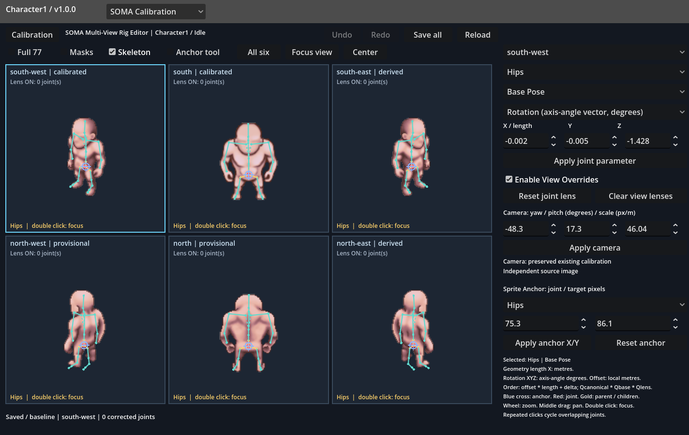
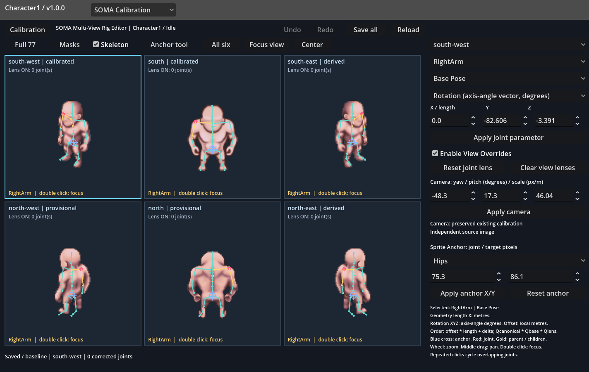
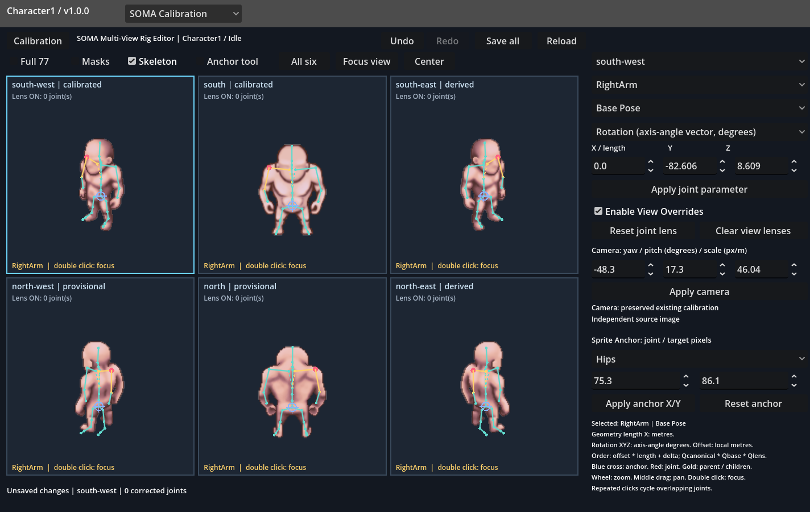
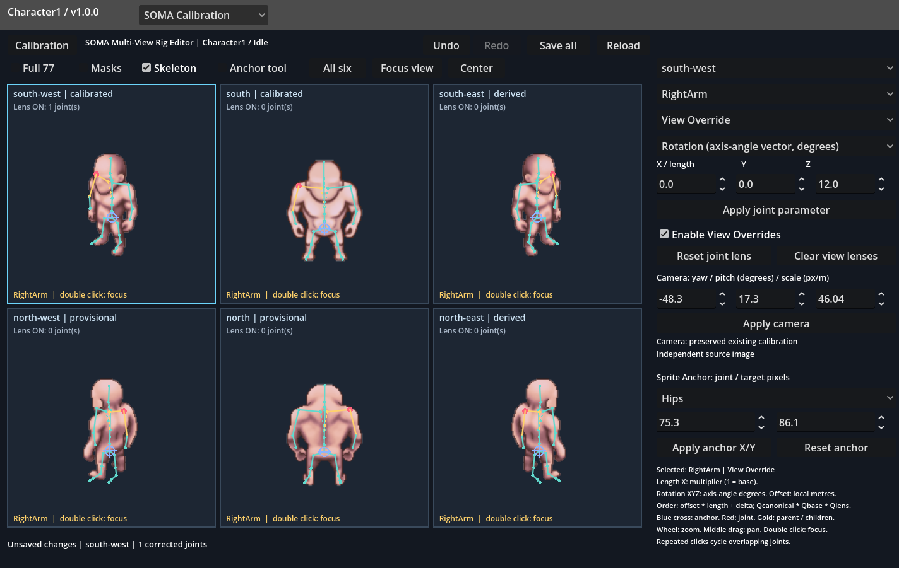
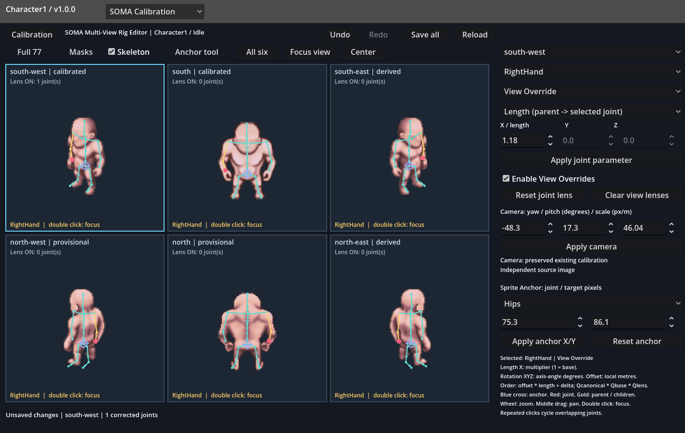
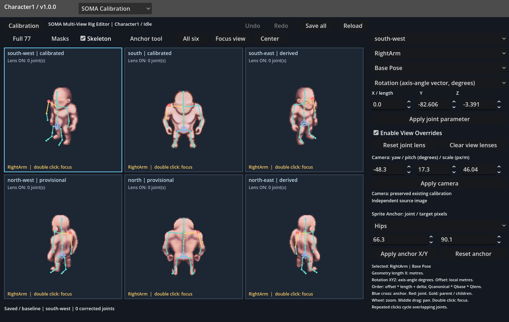
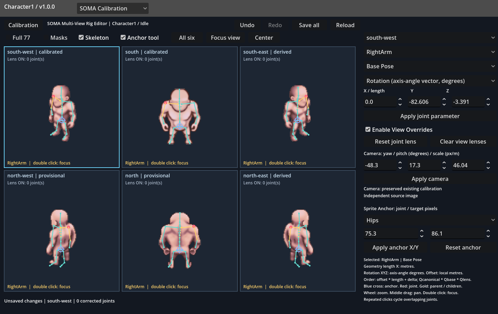
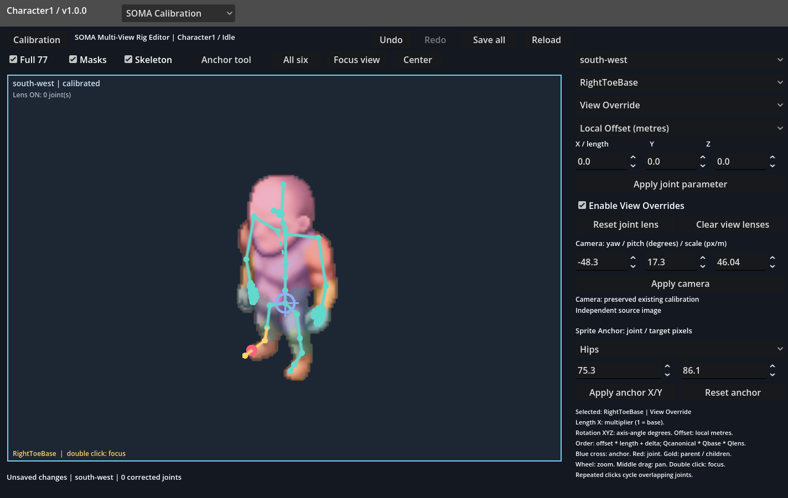
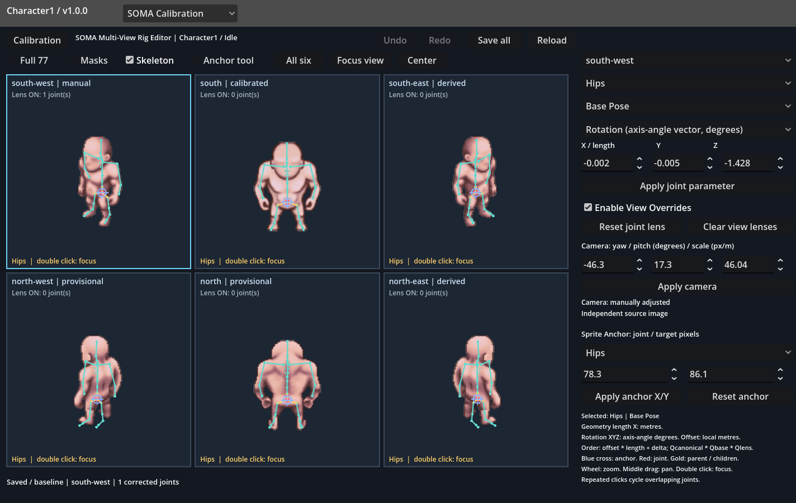

# SOMA Multi-View Rig Editor

## Result and launch

Status: **done** for the requested Character1 / Idle editor workflow. This is an
interactive mode inside Character Rigging Editor / SOMA Calibration, using a
static scene and the existing native sprites and anatomical chunks.

```powershell
.\godot\modules\character-rigging-editor\run.ps1 rig-editor
```

Alternatively open SOMA Calibration, then select `Multi-View Rig Editor` in the
Layer list. `Calibration` returns to the previous tools; unsaved rig edits are
saved before leaving that panel. The top-level editor quit/save flow also checks
the new mode's dirty state. Existing KeyPose and transitions remain separate.

1. Select a joint by clicking it or using the name list. Repeated clicks cycle
   overlapping joints. Selection is shared across all six views.
2. Choose `Base Pose`, `Character Geometry`, `View Override`, or `Camera / Anchor`.
3. Choose the parameter, edit X/Y/Z, then `Apply joint parameter`.
4. `View Override` length X is a multiplier; Geometry length X is metres.
5. Use `Anchor tool` and left drag to move the whole projected skeleton live.
6. Save all. Restarting `rig-editor` restores `soma/rig-editor/session.json`.

Undo/Redo buttons and Ctrl+Z/Ctrl+Y cover geometry, pose, camera, anchor and lenses.
Ctrl+S saves. Reload is itself undoable. View selection and canvas navigation do
not modify rig data. `Reset joint lens` clears only the selected joint's sparse
override; `Clear view lenses` clears that pose/view; neither resets the base.

## Architecture

One Character Geometry and one Base Pose feed all six projections:

`Geometry -> Base Pose -> sparse Pose/View lens -> FK -> View Camera -> Sprite Anchor`

`rig_model.gd` owns composition/validation/projection/persistence. `rig_canvas.gd`
draws and picks six projections without creating six rig instances.
`rig_panel.gd` owns tools and UndoRedo. Controls and canvas are explicit nodes in
`rig_panel.tscn`, instanced inside the existing SOMA panel. Scene generation is
an authoring utility; no nodes are constructed at runtime.

The canonical 77 names, parent indices, XYZW local rest rotations and metre/Y-up
convention remain pinned to the existing SOMA baseline. Shared geometry stores
77 local offsets. Base Pose stores local axis-angle vectors plus a separate
`root_translation_m`; root movement is applied before FK and remains distinct
from image placement. Rotation vector XYZ fields are degrees in the UI and
radians in saved data; they are **not Euler angles**.

The editable session references the immutable baseline fingerprint and model ID.
It saves geometry, pose, cameras, anchors and sparse lens dictionaries. It does
not serialize another canonical skeleton, another image inventory, or six
complete 77-joint poses. Full-precision JSON avoids rounded transform replay.
Validation rejects an incompatible baseline, non-finite transforms, unknown
override fields, nonpositive lengths/scales and camera tx/ty duplication.

Source: `Character1/idle/south@866f848c1b25ded2`. Initial world-position fingerprint:
`0eaf430c4008bff88f1a6bbec37632480782c1e361e11a025600f20b9b997f98`.

## Six cameras and reflection semantics

The actual `experiments/densepose-full-character-v1.0.0/source-inventory.json`
contains four original Idle directions and two derived reflections. East/West
are not invented. South and SouthWest preserve their previous exact numerical
calibrations. North and NorthWest optimize five camera/registration parameters
only against raw owner masks, alpha and uncertain anatomical intervals, with
the South geometry and all local rotations frozen. Previous independent fitted
North/NorthWest rigs are not model inputs.

| View | Basis yaw (deg) | Pitch (deg) | Scale (px/m) | Anchor offset X,Y (px) | Status |
| --- | ---: | ---: | ---: | --- | --- |
| south | 0.00000 | 0.00000 | 49.24165 | 55.00000, 125.33520 | preserved |
| south-west | -48.34525 | 17.25935 | 46.03745 | 75.33085, 130.58405 | preserved |
| south-east | -48.34525 | 17.25935 | 46.03745 | 74.66915, 130.58405 | reflected south-west |
| north | -171.82224 | 1.03133 | 49.36601 | 54.80833, 125.26423 | provisional |
| north-west | -122.24550 | -3.66888 | 48.26675 | 73.38693, 143.11191 | provisional |
| north-east | -122.24550 | -3.66888 | 48.26675 | 76.61307, 143.11191 | reflected north-west |

The mirrored rows deliberately retain the **source basis yaw**, with an explicit
`mirror_x` projection parity. They do not claim that negating yaw yields the
same asymmetric pose. Projection is `D * camera_basis * FK`, D=diag(-1,1) for a
derived view; the matching source image/chunks are also reflected in memory.
At migration, the horizontal anchor is `image_width - source_tx`. Thus for the
initial mirrored pair, x_derived = width - x_source and y_derived = y_source for
every anatomical joint. Pixel centres follow the existing half-pixel convention.
Left/right joint identities stay attached to their corresponding reflected
source pixels; no name permutation or hidden mirrored Base Pose is applied.

SouthEast is therefore a reflected SouthWest camera/image, NorthEast a reflected
NorthWest camera/image. Neither is independent evidence about depth. Their yaw
fields describe the source basis followed by parity, not an ordinary proper
rotation camera at the opposite azimuth. This convention is visible in the
camera status, serialized explicitly, and tested on all 77 projected joints.
After initialization each direction can be edited independently as required;
editing a source camera does not silently modify its derived direction.

North/NorthWest remain **provisional**, visibly marked in each cell. NorthWest
still has hand, forearm and toe discrepancies; source masks need review and a
single frozen South pose cannot explain every artistic difference. North's
hidden attachment points are also not independently verified. Numerical mask
support is a diagnostic, not joint ground truth. Details and per-joint intervals
are retained in `soma/rig-editor/camera-validation.json`.

## Sprite Anchor

There is exactly one 2D translation, `anchors[image_id].offset_px`. Camera tx/ty
are migrated into it and removed from the new camera records. Default joint is
Hips, but all 77 joints are available in `AnchorJoint`.

The target pixel is derived as `unshifted_projection(anchor_joint) + offset`.
Dragging or applying target X/Y sets `offset = target - unshifted_projection`.
Changing the chosen anchor joint preserves the current offset and visual result.
Reset restores the initial image registration. Geometry/pose/camera edits keep
image translation fixed and refresh the displayed target; the anchor does not
pin a joint against subsequent pose edits. This avoids cancelling intentional
pose or root movement. Target and offset are saved consistently per image.

Dragging updates all 77 points in that image immediately. Release creates one
UndoRedo action. It changes no camera angle/scale, shared geometry, local
rotation, root position, or other image anchor.

## Geometry, pose and corrective lenses

Each lens is keyed by `idle/view`, with `enabled` and a sparse `joints` dictionary.
Only actual non-neutral corrections are stored. Reset removes records rather
than saving a full pose. The evaluator starts from current shared data every time.

For joint j, before parent-to-child FK:

```text
offset_effective[j] = offset_geometry[j] * length_multiplier[j] + offset_delta[j]
Q_effective[j] = Q_canonical[j] * Q_base_pose[j] * Q_rotation_override[j]
P_world[j] = P_world[parent] + Q_world[parent] * offset_effective[j]
Q_world[j] = Q_world[parent] * Q_effective[j]
```

Missing multiplier is 1; missing vectors are zero. Length is applied once,
then an unscaled local offset is added once. Quaternion multiplication is
ordered and noncommutative: the lens is relative to the current base local pose,
not an absolute world orientation or a sum of rotation vectors. Rotation changes
descendants; incoming segment length and offset change the joint and its whole
descendant chain. Disabling a lens bypasses all three corrections and leaves
their records intact for reenabling. A new base pose/geometry does not erase it.

The UI labels length as `parent -> selected joint`: to change the forearm segment
`ForeArm -> Hand`, select Hand; to change `Foot -> ToeBase`, select ToeBase.
This directly edits SOMA local offsets, preserving the complete parent chain.
The `Character Geometry` scope uses absolute local offsets/metre lengths;
`Base Pose` uses absolute local rotation vectors and pose root translation;
`View Override` uses relative rotation, length factor and local offset delta.

No arbitrary depth is inferred from a 2D joint drag: 3D editing is explicit via
numeric controls. Direct canvas dragging is reserved for the unambiguous 2D
image anchor. This avoids undocumented depth changes.

## Real interface evidence

These are actual GPU Godot viewport captures, not Python renders. The test drives
the real controls/signals and canvas mouse handler. Demonstration edits are
isolated in `proof-session.json` / `proof-reload-input.json`; normal user
`session.json` is not overwritten by tests.

1. Six original/derived Idle images on one screen, one shared SOMA.



2. RightArm selected and highlighted in all six views, with parent/children.



3. RightArm Base Pose rotation vector Z increased by 12 degrees. The visible
SouthWest hand moves down; all six projections respond to the same 3D edit.



4. A relative RightArm rotation of 12 degrees around local Z affects only
SouthWest. The other five views retain their initial projected coordinates.



5. RightHand incoming segment multiplier 1.18 changes `ForeArm -> Hand` length,
moving the hand and its finger descendants while keeping shared geometry intact.



6. A deliberately introduced whole-image misregistration (-9,+4 px) is corrected
by an Anchor drag (+9,-4 px), restoring the calibrated alignment without changing
any joint parameter. This is an anchor-tool demonstration, not a new anatomical
calibration claim.





Full 77, anatomical masks and focused single-view mode are also available.
`All six` restores the grid; `Center` resets canvas zoom/pan. Display zoom uses
one common native-pixel scale fitted against the largest source dimensions,
so 110x110 sources are not enlarged relative to 150x150 sources. The wheel
changes that shared zoom in all six windows and keeps the grid visible.
Use `Focus view` or double click for single-view inspection; middle drag pans.
`Skeleton` off compares the source alone. Display zoom never changes camera
scale, geometry, pose or anchors.



Saved camera, anchor, pose and combined lens after restarting Godot:



## Verification

`run.ps1 rig-proof` verifies actual UI behavior; `run.ps1 rig-reload` starts a
fresh process and compares all six saved projections, all 77 points per view,
within 0.0001 native pixels. Twelve repeated save/reload cycles and eight lens
disable/enable cycles show no accumulation. The original South FK is preserved
within 0.00001 metres (Godot's float32 vectors/quaternions).

- Shared display zoom: identical native-pixel scale across six sizes; wheel changes all views; Center resets without editing calibration
- A: six cameras; frozen South FK; exact mirrored raster with unchanged anatomical identities
- B: real canvas anchor drag moves all 77 points rigidly in one view; undo / redo
- C: shoulder Base Pose changes all six projections; geometry remains shared
- D: relative rotation isolated to SouthWest
- E: parent-to-selected forearm length scales by 1.18; hand children move; other views / base unchanged
- F: local shoulder offset moves its connected chain only in SouthWest
- G/H: rotation + length + offset composed before FK; lens survives changed Base Pose
- I: eight disable / enable cycles with no accumulation
- Geometry: spine offset changes all six views without pose mutation
- Base Pose root translation is independent of image anchor and shared geometry
- Foot: ToeBase length / offset moves ToeEnd through connected FK; selected lens reset
- Navigation: Full 77, masks, focus, all six, centering, source-only
- J: all six edited projections reproduced in a fresh Godot process

The noncommuting quaternion product is checked independently for a shoulder
child; simultaneous length and offset are checked against the expected local
segment norm. The general geometry tool changes a spine offset across all views;
the foot tool changes ToeBase length/offset and moves ToeEnd through FK.

Previous `mv-test`: 12 tests passed, including exact frozen South transforms,
source preservation and camera-only migration. The existing editor `test` also
passed all 14 checks / 12 endpoints on its repeat run. Its first run failed the
time-dependent AnimationPlayer loop-resumption assertion; no playback code was
changed to bypass it. All new changes stay inside
the Character Rigging Editor module. No source sprites/masks, MotionBricks,
Workbench, canonical hierarchy or legacy KeyPose/transition data are modified.
No animation generation, commit or push is performed.

Reproduction:

```powershell
.\godot\modules\character-rigging-editor\run.ps1 rig-prepare
.\godot\modules\character-rigging-editor\run.ps1 rig-proof
.\godot\modules\character-rigging-editor\run.ps1 rig-reload
.\godot\modules\character-rigging-editor\run.ps1 rig-report
```

`rig-prepare` regenerates initial camera hypotheses/static scenes and does not
overwrite a user session. The seed is immutable context for session validation;
explicitly version a changed South baseline rather than replacing it silently.

## Remaining limits

- Only Character1 / Idle has calibrated images and is exposed by this mode.
  Direction cameras are stored independently of pose and future poses can reuse
  them with separate image anchors/lenses; Walk/Aim are not mass-calibrated here.
- Four source directions constrain the model; the other two are explicit image
  reflections. Occluded shoulders/hips and depth remain uncertain. NorthWest
  is provisional, with residual artistic/segmentation mismatches.
- Joint tools are numeric; there is no unconstrained 2D-to-3D dragging or IK.
  The editor currently targets the existing 1440x940 window layout.
- Lenses can deliberately violate anatomical proportions for readability; they
  are relative artistic edits, not independently reconstructed anatomy. Proof
  edits demonstrate the tools and do not overwrite the initial calibration.

Engine references consulted for implementation:
[Quaternion](https://docs.godotengine.org/en/stable/classes/class_quaternion.html),
[UndoRedo](https://docs.godotengine.org/en/stable/classes/class_undoredo.html).
