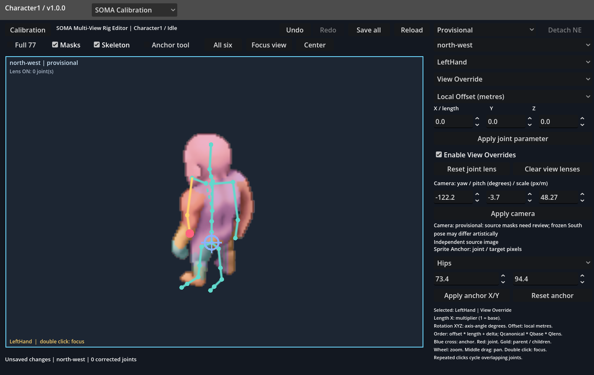
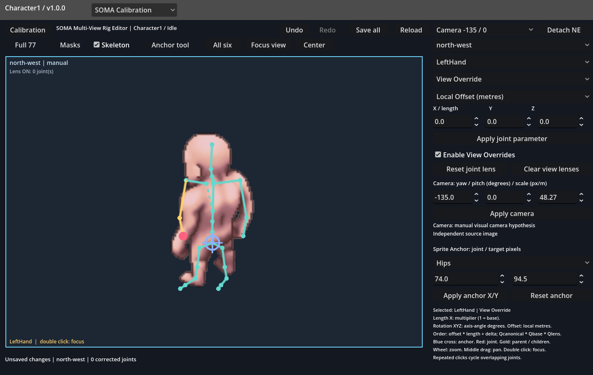
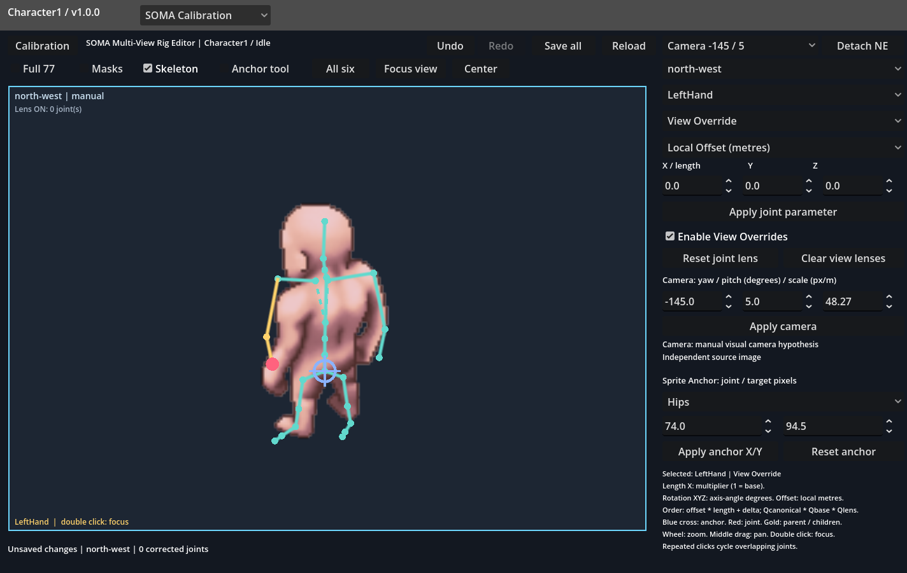
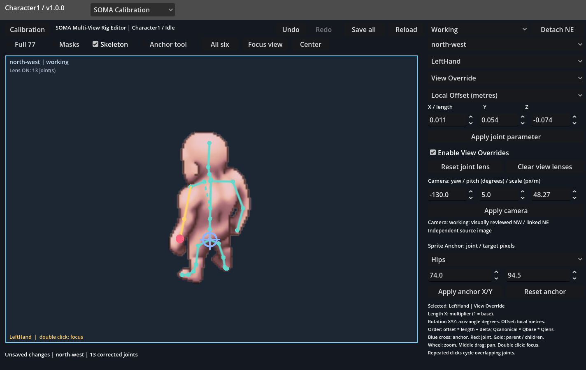
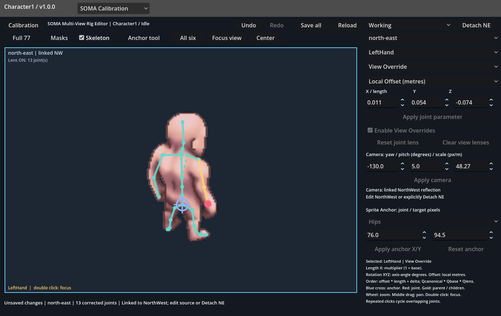
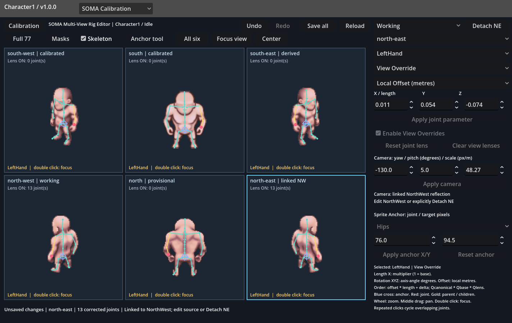
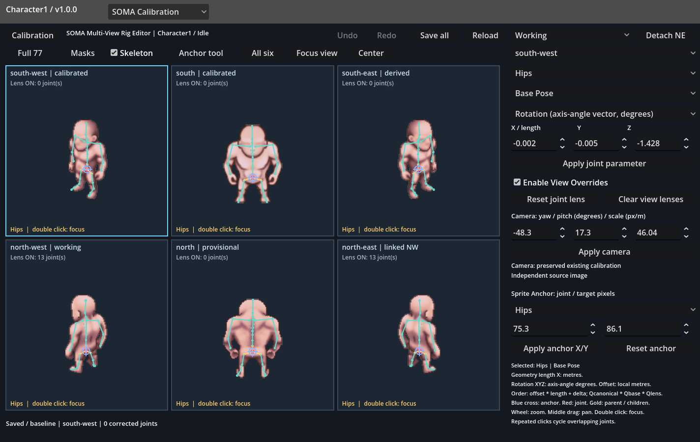

# NorthWest Idle: рабочая калибровка

Статус: **done**. Исходный коммит: `c8e948b6`. Проверен реальный Godot UI,
включая чистый спрайт, чанки, кисти и стопы крупным планом. Рабочее состояние
сохранено отдельно от исходного provisional и загружается обычным редактором.

## Открытие и сравнение

```powershell
.\godot\modules\character-rigging-editor\run.ps1 rig-editor
```

В правом верхнем списке доступны:

- `Provisional`: прежние камера, Anchor и отсутствие линзы.
- `Anchor only`: только регистрация Hips в точке (74, 94.5).
- `Camera -135 / 0`, `Camera -145 / 5`, `Camera -130 / 5`: явные гипотезы
  камеры на неизменной общей геометрии и Base Pose.
- `Working`: выбранная камера, Anchor и 13 разреженных Offset Overrides.

Переключение профиля заменяет только северную пару и поддерживает Undo/Redo.
Изменения остальных направлений и текущей общей базы не сбрасываются.
`Enable View Overrides` в NorthWest отключает/включает линзу, сохраняя камеру
и Anchor. `All six` возвращает шестипроекционный экран. Можно продолжать
редактирование обычными инструментами и сохранять кнопкой `Save all`.

Файлы:

- `soma/rig-editor/seed.json`: прежняя provisional-калибровка, не изменён.
- `soma/rig-editor/north-west-calibration.json`: отдельные профили сравнения;
  содержит камеру, Anchor и разреженную линзу, а не новый 77-суставный скелет.
- `soma/rig-editor/north-west/working.json`: отдельная сохранённая рабочая
  конфигурация для восстановления.
- `soma/rig-editor/session.json`: активная редактируемая конфигурация, которую
  открывает редактор при следующем запуске.

## Визуальная диагностика

Глобальная регистрация уже была близка: Hips был в (73.3869, 94.3614),
поэтому перенос к (74, 94.5) составляет всего (+0.6131, +0.1386) px.
Такой Anchor не может одновременно исправить направления обеих рук и стоп.
Позвоночная цепь в основном проходит через корпус; специальная правка общей
геометрии позвоночника или таза не понадобилась.

Ближнее плечо было слишком высоко, кисть смещена внутрь/вверх. Дальний локоть
располагался слишком близко к корпусу и низко. Ближняя стопа продолжалась за
альфа-контур вниз; дальняя стопа выводилась за видимую укороченную/перекрытую ногу.
Колено и голеностоп ближней ноги были значительно ближе к изображению, чем пальцы.

Расстояния кистей 11.42 и 12.60 px в прежнем диагностическом отчёте считаются
до эвристических точек (69.95,95.95) и (82.5,103.5). На реальном спрайте эти
ориентиры оказываются в области таза/ног и не являются центрами видимых кистей.
Их нельзя использовать как точную цель оптимизатора. Для ручной доводки выбраны
видимые запястья приблизительно (56.5,94) и (90,89), с проверкой по силуэту.
Это ручная интерпретация, а не независимая разметка скрытой анатомии.

## Камера и линза

Выбран yaw **-130 градусов**, pitch **+5 градусов**, масштаб **48.2667469744 px/m**.
Единственный перенос находится в Anchor: offset=(74,143.1626692357),
Hips target=(74,94.5). Камера не содержит второго tx/ty.

Вариант -145/+5 чрезмерно расширяет плечевой пояс и уводит локти наружу.
-135/0 улучшает некоторые точки рук, но оставляет неудачные плечи и обе стопы.
-130/+5 даёт более подходящую общую фигуру, сохраняя регистрацию головы и корпуса.
Сам по себе этот вариант всё ещё выводит пальцы стоп за спрайт: улучшение камеры
не выдаётся за полное исправление локальной позы.

Рабочая линза исправляет оба плечевых конца, локти и запястья, ближнюю стопу
с ToeBase/ToeEnd и дальнюю цепь от Shin до ToeEnd. Содержит 13 записей
`local_offset_delta`; нейтральные Rotation/Length не записываются. Исправления
компонуются до FK и перемещают дочерние цепи. Их можно заменить или дополнить
обычными Rotation/Length инструментами при дальнейшей ручной работе.

`north-west-review.json` хранит выбранные вручную точки и ограничения.
Вспомогательный `soma_north_review.py` только переводит заданное вручную смещение
в плоскости камеры в родительские локальные метры при неизменной глубине.
Он не подбирает анатомию, не оптимизирует позу и не создаёт новый solver.
Основной результат — загружаемая линза в существующем интерактивном редакторе.

## NorthEast: живая связь через отражение

В рабочей конфигурации явно сохранено
`view_links: {"north-east":"north-west"}`. NorthEast использует текущую камеру,
Anchor и линзу NorthWest через отражение x -> 150-x. Анатомические имена остаются
прежними; нового распознавания, отдельной позы или копии 77 суставов нет.
Все 77 проекций проверены: x_NW+x_NE=150, y_NW=y_NE.

Независимые инструменты NorthEast заблокированы до нажатия `Detach NE`.
Разъединение сохраняет текущий вид и материализует только параметры камеры,
Anchor и разреженной линзы; после него правки NE не влияют на NW. Undo возвращает
живую связь. При сохранении производные параметры согласуются с источником,
а сама линза остаётся записана один раз у NorthWest.

## Измерения по альфа-контуру

Проверена именно удалённость отображаемых точек от исходного непрозрачного
силуэта (билинейная выборка distance transform). Ноль означает нахождение внутри
силуэта, а не доказательство анатомической точности или независимую оценку качества.

| Стадия | Сустав | Координаты, px | За альфой, px |
| --- | --- | --- | ---: |
| Provisional | LeftHand | 60.81, 89.10 | 0.00 |
| Provisional | RightHand | 87.09, 91.76 | 0.26 |
| Provisional | LeftToeEnd | 56.09, 120.35 | 3.69 |
| Provisional | RightToeEnd | 72.74, 122.04 | 5.52 |
| Anchor only | LeftHand | 61.42, 89.24 | 0.00 |
| Anchor only | RightHand | 87.70, 91.90 | 0.40 |
| Anchor only | LeftToeEnd | 56.71, 120.49 | 3.50 |
| Anchor only | RightToeEnd | 73.35, 122.18 | 6.05 |
| Camera -130 / 5 | LeftHand | 58.69, 92.27 | 0.00 |
| Camera -130 / 5 | RightHand | 90.35, 88.98 | 0.00 |
| Camera -130 / 5 | LeftToeEnd | 55.85, 121.37 | 4.70 |
| Camera -130 / 5 | RightToeEnd | 75.90, 119.29 | 6.66 |
| Working | LeftHand | 56.50, 94.00 | 0.00 |
| Working | RightHand | 90.00, 89.00 | 0.00 |
| Working | LeftToeEnd | 57.80, 115.20 | 0.00 |
| Working | RightToeEnd | 84.00, 111.50 | 0.00 |

На рабочем варианте обе кисти и оба ToeEnd находятся внутри альфа-контура;
визуально проверены направления предплечий и продолжение ног. Частично скрытая
дальняя стопа оставлена компактной в пределах видимого силуэта. Её скрытая
анатомия не считается восстановленной.

## Реальные снимки Godot

До исправления:


Чанки на исходной калибровке:



Только Anchor:


Кандидаты камеры:





Выбранная камера и Anchor, без локальной линзы:


NorthWest после локальной доводки:



NorthEast с отражёнными исправлениями:



Все шесть направлений:



Восстановление рабочей конфигурации в новом процессе:



## Проверки и границы

- shared geometry / Base Pose unchanged
- four unrelated views unchanged
- six camera/registration/lens comparison stages in real Godot UI
- all 77 mirrored NorthEast joints exact
- linked NE editing locked until explicit detach
- lens disable/enable restores both North views without accumulation
- manual joint edit propagates through live reflection link
- detach preserves appearance; subsequent NE edit isolated; undo restores link
- separate working profile and normal session saved / reloaded
- Перезапуск Godot: все 77 точек во всех шести видах воспроизводятся
  с допуском 0.0001 native px.
- Прежний `rig-proof`: 13 проверок прошли; `rig-reload` также прошёл.
- Геометрия, вращения и root translation общей South-базы численно неизменны.
  При сравнении JSON до/после допускается только погрешность сериализации
  до 1e-15 в метрах/радианах; исходные файлы базы сохранены побайтно.
- Проверены исходные хеши South и всех файлов из signature NorthWest,
  включая исходные изображения и DensePose/Flood Fill.

Сохраняются ограничения художественной реконструкции: глубина, скрытые плечевые
основания и перекрытая дальняя стопа неоднозначны. Профиль рассчитан на текущий
Character1 / Idle; остальным позам эти поправки автоматически не назначаются.
Исходные спрайты/маски, MotionBricks, Workbench и старые KeyPose не изменены.
Commit/push не выполнялись.

Проверку стадий можно повторить `run.ps1 north-proof`, затем
`run.ps1 north-reload`. **north-proof сохраняет Working в активный session.json**;
для обычного просмотра и редактирования используйте `rig-editor`.
